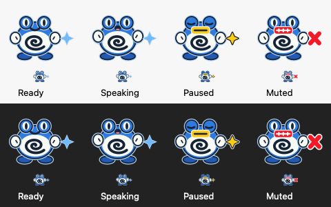

# Poliwhirl

Poliwhirl is the macOS menu bar control for Claude and Codex speech. The icon shows when speech is ready, playing, paused or muted. Click it to pause or resume. Double-tap Control to toggle mute. Right-click for voice, speed and YouTube Music controls.



## Restore on another Mac

Use the Xcode Command Line Tools (including `swiftc`), Python 3, Node.js and `jq`. From the root of a fresh clone:

```sh
./scripts/build.sh
python3 scripts/restore.py
launchctl bootstrap "gui/$(id -u)" "$HOME/Library/LaunchAgents/com.zwang.capsmute.plist"
```

The build compiles both the menu app and audio player and exercises their controls and the extension offline. Restore installs the hooks and launch agent under your home directory. It keeps existing voice preferences and stops if an existing hook differs. The login agent starts Poliwhirl now and at subsequent logins.

- **Speech.** Connect the restored hooks to Claude and Codex using the [speech setup instructions](docs/speech.md). macOS supplies a built-in voice. To restore the Phonon Harper and Zoey voices, install `uv` and run `./scripts/restore-phonon.sh`. The restore uses Zoey at 1.4×. Configure any private summarization credentials on the new Mac.
- **YouTube Music.** In Chrome, open `chrome://extensions`, enable **Developer mode**, and choose **Load unpacked**. Select `~/Library/Application Support/Poliwhirl/chrome-extension`. In Poliwhirl’s menu, enable **Pause music while speaking**. Restore generates a local pairing shared by the app and extension.
- **Artwork.** The [artwork history](artwork/README.md) includes the editable drawings and previews for five revisions.

The [November 23 backup](https://github.com/MrMegaMango/poliwhirl/releases/tag/backup-2026-11-23) contains the two original Apple Silicon executables from the running installation. Building from source produces binaries for the Mac you run it on.
